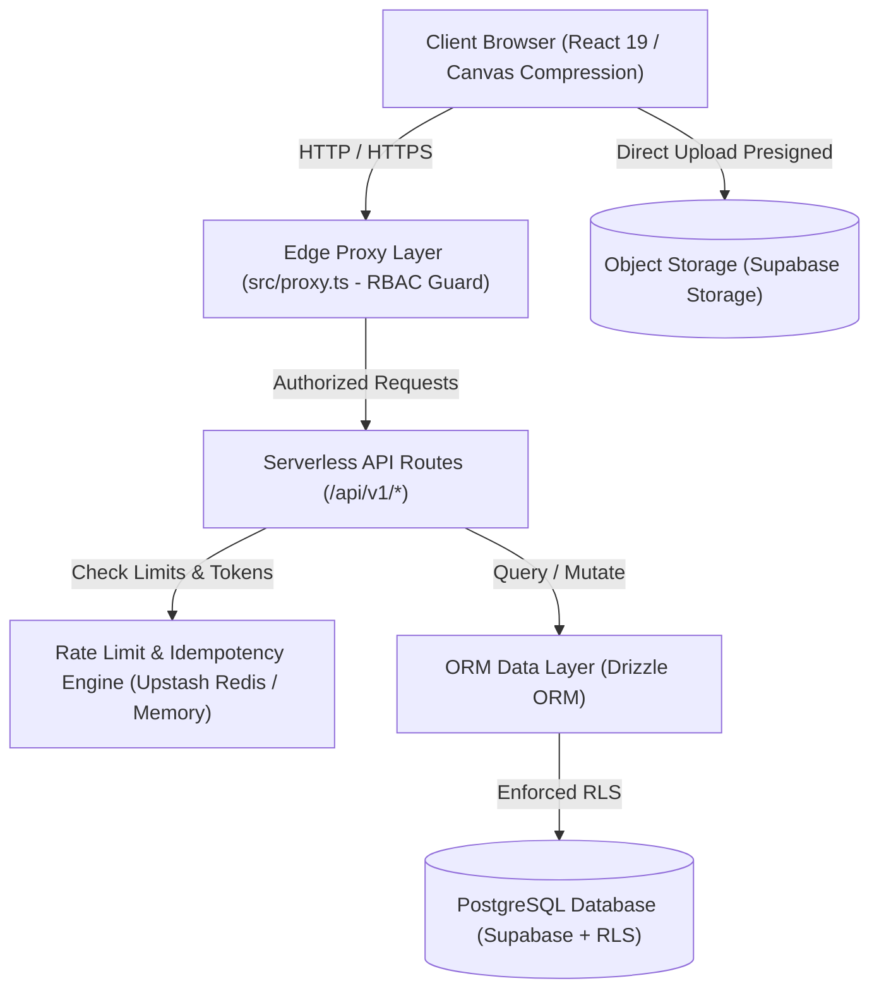
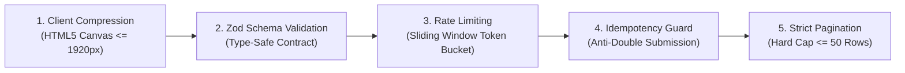

# 🏗️ System Architecture Specification

**Project:** PambantuLog  
**Status:** Production Ready (v2.0)  
**Target Environment:** Vercel (Edge & Serverless Node.js Runtime)  
**Data Layer:** PostgreSQL (Supabase) & Distributed Cache (Upstash Redis)

---

## 1. Architectural Overview

PambantuLog is built as a cloud-native, serverless helpdesk platform optimized for zero cold-start latency, strict resource limits, and high database durability. The architecture follows a multi-tier defense pattern:



---

## 2. Security & Access Control Model

### 2.1 Next.js 16 Edge Proxy RBAC (`src/proxy.ts`)
All incoming requests pass through the Edge Proxy before executing page components or API handlers:
- **Session Resolution**: Decodes and verifies Supabase auth cookies in serverless edge context.
- **Route Matrix**:
  - `/admin/*`: Restricted to `ADMIN` and `AGENT` roles. Creation of employee accounts (`/admin/employees/create`) is strictly reserved for `ADMIN`.
  - `/employee/*`: Restricted to `EMPLOYEE` role.
  - `/login`: Automatically redirects already-authenticated sessions to their corresponding role landing page.
- **Unauthorized Redirection**: Unauthenticated requests are directed to `/login?redirectTo=<dest>` while role violations redirect to `/unauthorized`.

### 2.2 Database Row Level Security (RLS)
PostgreSQL policies guarantee multi-tenant boundary isolation:
- `EMPLOYEE`: Can only select and insert tickets authored by `auth.uid() = createdById`.
- `AGENT`: Read access to all tickets; write/update access restricted to status transitions and comments.
- `ADMIN`: Global SELECT, INSERT, UPDATE, and DELETE across all entities.

---

## 3. Serverless Restrictions & Workload Protection

To prevent runaway cloud costs and database exhaustion in serverless environments, PambantuLog enforces 5 distinct layers of protection:



### 3.1 Client-Side Adaptive Canvas Compression (`src/lib/file-compression.ts`)
- **Downscaling**: Automatically resizes images with dimensions exceeding 1920px (preserving aspect ratio) using an off-screen HTML5 Canvas.
- **Compression**: Encodes output to WebP (with JPEG fallback) at `quality = 0.8`, targeting 300–600 KB file sizes.
- **Extension & MIME Whitelist**: Only `.png`, `.jpg`, `.jpeg`, `.webp`, `.pdf`, `.log` files are accepted. Dangerous executables (`.exe`, `.bat`, `.sh`, `.cmd`) are immediately rejected.
- **Attachment Ceiling**: Maximum of 5 files per ticket submission.

### 3.2 Dual-Driver Rate Limiting (`src/lib/rate-limit.ts`)
- **Primary Driver**: `@upstash/ratelimit` over REST for distributed multi-instance edge isolation.
- **Fallback Driver**: High-performance in-memory sliding window token bucket for local development and offline environments.
- **Rule Definitions**:
  - `TICKET_CREATE`: Max 5 requests / 10 minutes per IP/User ID.
  - `TICKET_COMMENT`: Max 15 requests / 1 minute per User ID.
  - `AUTH_LOGIN`: Max 5 failed attempts / 15 minutes per IP/identifier.
- **Non-Consuming Inspection**: Features `peekRateLimit()` for preliminary checks without consuming consumer quota prematurely.

### 3.3 Idempotency Engine (`src/lib/idempotency.ts`)
- Prevents duplicate ticket creation from accidental double-clicks or browser retry events.
- Tracks `Idempotency-Key` headers in transient cache with a 120-second TTL.
- Concurrent requests with identical keys are intercepted and returned with `HTTP 409 Conflict`.

### 3.4 Strict Query Pagination & Search Debounce (`src/lib/pagination.ts`)
- **Hard Cap**: Request parameter `limit` is strictly bounded via `Math.min(limit, 50)`, defaulting to 20 rows.
- **Index Sanitization**: Negative or non-numeric `page` parameters are coerced to 1.
- **Client Debounce (`src/hooks/useTicketSearch.ts`)**: Implements a 350ms debounce window before search query triggers backend network calls.

### 3.5 Export Guard & Throttling (`src/lib/export-guard.ts`)
- Restricts ticket reporting queries to a maximum 30-day window (`startDate` to `endDate`).
- Hard caps query extraction results at 1,000 records per export job.
- Enforces a 2-minute user cooldown between CSV generation requests.
- RFC 4180 compliance prevents CSV injection vulnerabilities.

---

## 4. Data Layer & State Machine

### 4.1 Schema Topology (Drizzle ORM)
- **`users`**: Master profile record linked 1:1 to Supabase `auth.users`. Contains `role` (`ADMIN`, `AGENT`, `EMPLOYEE`), department, and active status.
- **`categories`**: Master incident categories (Hardware, Software, Network, Access).
- **`tickets`**: Incident records tracking `title`, `description`, `priority`, `status`, `createdById`, `assignedToId`, and `attachmentUrl`.
  - *Attachment Backward Compatibility*: Stores multiple attachment URLs as a stringified JSON array `["url1", "url2"]` while supporting legacy single URL strings transparently.
- **`ticket_comments`**: Audit-trailed conversation log with optional attachment references.

### 4.2 Ticket Lifecycle State Machine
```text
[ OPEN ] ───► [ IN PROGRESS ] ───► [ WAITING ON USER ]
                    │                        │
                    ▼                        ▼
              [ RESOLVED ] ──────────► [ CLOSED ]
                    │
           (Triggers CSAT Form)
```

---

## 5. API Registry & Backward Compatibility

| Method | Endpoint | Description | Guard / Protection |
| :--- | :--- | :--- | :--- |
| `POST` | `/api/v1/auth/login` | User authentication | Rate Limit (5 / 15m), Cookie Set |
| `GET` | `/api/v1/auth/me` | Fetch active profile | Session Guard |
| `POST` | `/api/v1/auth/logout` | Terminate session | Session Guard, Cookie Clear |
| `GET` | `/api/v1/tickets` | Paginated ticket list | Strict Pagination (Cap 50), Role Filter |
| `POST` | `/api/v1/tickets` | Create ticket | Rate Limit (5 / 10m), Idempotency, Zod Schema |
| `GET` | `/api/v1/tickets/:id` | Ticket detail & audit | RLS Role Guard |
| `PATCH`| `/api/v1/tickets/:id/status` | Advance ticket state | State Machine Guard, Agent/Admin Only |
| `POST` | `/api/v1/tickets/:id/comments` | Add reply to thread | Rate Limit (15 / 1m), Zod Schema |
| `GET` | `/api/v1/tickets/export` | Download CSV export | Export Guard (30-day range, 2m cooldown) |
| `ALL` | `/api/tickets` | Legacy v0 route | **HTTP 308 Permanent Redirect** to `/api/v1/tickets` |
